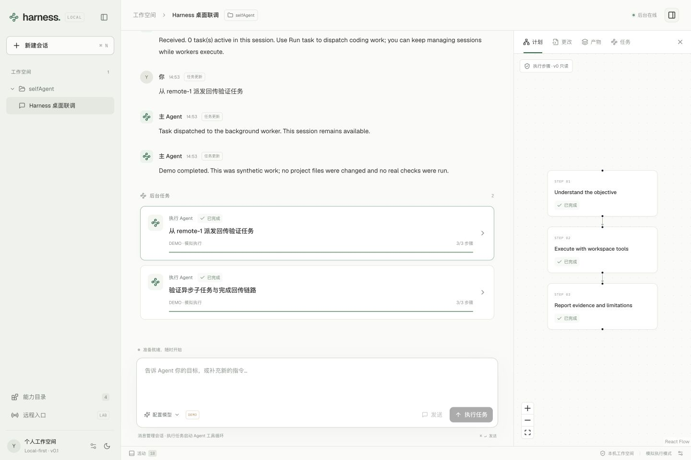

# Self Agent

一个本地优先的 Harness Agent 桌面工作台。通过对话生成可编辑计划、异步派发子任务，并由主智能体回顾结果、继续执行和回传。

采用 **Rust daemon + Tauri 2 + React / TypeScript**。桌面以 Codex 风格的会话工作台组织项目、对话、任务卡片和侧边工作面板。



## 当前版本

当前版本 **0.3.0** 已完成编排闭环，并接入 Codex 执行器与子智能体角色：

- 独立 Rust 后台、本机令牌认证、SQLite 持久化会话与任务。
- 模型驱动的主智能体：发送目标立即返回，后台生成计划草稿，子任务执行期间继续接收消息。
- 可编辑的草稿任务、描述和依赖，版本检查、循环依赖验证，以及真实依赖图。
- 审阅后启动计划，按依赖调度子任务，将前置结果传给后续任务；主智能体回顾后完成、追加工作或请求人工介入。
- 每个计划最多 3 轮、累计 12 个节点，独立任务 worker 与主智能体 worker；同项目的工具执行保持单写。
- Chat Completions 兼容网关的原生 agent 工具循环，支持工作区文件读取、搜索、写入，以及显式启用的命令执行。
- 清楚标注的演示模式，在没有模型凭据时验证异步执行和通知链路。
- 固定任务回传目标、持久化通知队列、模拟远程入口和投递记录。
- 中文 React 桌面界面、中性灰与蓝色明暗主题、任务详情和计划可视化，以及保持 daemon 独立运行的 Tauri 桥接。
- 本机 Codex app-server 执行器，独立任务会话、真实终态检查、取消中断与进程回收。
- 可编辑角色名称、职责、执行器和模型；每个草稿节点选择执行角色，配置随计划和任务固化。
- 原生窗口标题栏随明暗主题同步，修正顶部栏与工作区背景失配。

计划先形成草稿供你审阅，启动后在预算内自动继续。当前仅草稿可编辑；执行中不能重写计划。有失败、取消或阻塞的历史节点时，即使追加的修复任务成功，整个计划仍保留为待确认，避免自动掩盖失败。可补充目标生成新计划，或取消旧计划。

外部 MCP / Skills 的应用内管理、真实通讯平台和移动端尚未接通。主 Agent 与原生执行器仍使用非流式 Chat Completions，Codex 子任务通过独立 stdio 协议运行。

## 使用流程

1. 新建会话并选择已有项目目录，在设置中配置模型或明确启用演示模式。
2. 在输入区选择「发送目标」，主智能体在后台生成计划；讨论性消息可以直接回复，不强制创建计划。
3. 在右侧「计划」中修改任务标题、完整描述和依赖，保存后点击「启动计划」。
4. 子任务在后台执行，依赖图展示实际状态。主智能体根据结果汇总，或在预算内追加任务。你可以继续发消息、管理其他会话或取消计划。
5. 如需绕过规划、运行单个任务，使用次要操作「直接执行」。

## Codex 与子智能体角色

在设置页添加角色，选择「原生工具循环」或「Codex 本机 CLI」，填写职责并选择默认角色。计划草稿中可逐节点选择角色。主 Agent 的规划与回顾仍使用上方配置的兼容模型；如果只想直接执行 Codex 任务，可以不配置主 Agent 模型。

Codex 需要先在本机安装、完成登录并配置可用模型。在设置中填写 Codex 命令名或绝对路径，保存后点击检测。检测只运行 `--version`，不验证登录或调用模型。原生角色的模型留空时继承主 Agent 模型；Codex 角色留空时使用本机 Codex 配置。GUI 找不到 CLI 时请填写绝对路径，执行器会为子进程补充该文件所在目录的 PATH。

角色配置在发送目标时随编排作业保存；草稿、自动追加节点和延迟派发任务均使用该计划的角色快照。之后修改设置不会改变旧计划。当前最多 16 个角色；直接任务也会保存其执行角色。

每个 Codex 子任务使用新的临时会话，通过 `initialize → thread/start → turn/start` 执行，只有收到真实完成状态和最终结果才报告成功。当前没有复用 Codex 历史会话，也没有人工审批交互。执行权限为 `workspace-write`，禁止命令网络和额外临时目录写入，额外授权请求会被拒绝并终止。它仍继承本机 Codex 的登录和工具配置；第三方 MCP 的远端操作不属于本机文件沙箱的保障范围。

Codex 单任务最多 15 分钟、协议总输出 8 MiB、最终结果 128 KiB；取消时先中断回合，再回收执行器进程及其子进程。已验证本机 `codex-cli 0.163.0` 初始化与会话协议，模型执行链路使用本地夹具验证，未使用真实云端模型验证输出质量。

## 开发环境

- Rust **1.96 或更新版本**。
- Node.js **24**，项目使用的 pnpm 版本见 `package.json`。
- Tauri 平台构建依赖：macOS 需要 Xcode Command Line Tools；Windows 需要 MSVC C++ 构建工具及 WebView2；Linux 需要 WebKitGTK 4.1、GTK 和相关开发包。

安装前端依赖并启动桌面：

```sh
pnpm install
pnpm dev
```

启动脚本先构建 daemon、准备桌面 sidecar，再启动 Tauri 和 Vite。关闭桌面后 daemon 继续运行；任务与会话保存在平台本地应用数据目录的 `self-agent` 子目录中。

仅启动后台：

```sh
cargo run -p harness-daemon
```

仅启动浏览器开发界面时，先运行 daemon，再运行：

```sh
pnpm dev:web
```

默认开发地址为 `http://127.0.0.1:1420`。Vite 代理从本机私有元数据读取后台令牌，前端构建产物不包含该令牌。开发服务器只应监听本机。

## 配置模型

通过设置界面填写兼容 Chat Completions 的网关地址、模型与 API Key。主智能体需要模型支持 JSON 对象输出，执行智能体需要支持工具调用。在设置页输入的密钥只保存在 daemon 内存中；重启后需要重新输入，或改用环境变量。

```sh
export HARNESS_BASE_URL=https://api.openai.com/v1
export HARNESS_MODEL=gpt-4.1
export HARNESS_API_KEY=your-key
pnpm dev
```

`HARNESS_BASE_URL` 指向包含 `/v1` 的 API 根地址，不包含 `/chat/completions`。项目不会自动加载 `.env` 文件。更多配置见 [.env.example](.env.example)。

没有模型凭据时，可以在设置中显式切换为演示模式。主智能体会生成固定中文演示草稿；启动后只产生模拟步骤和通知记录，不修改项目、不声称通过真实测试。

文件工具使用项目相对路径。命令执行默认关闭，启用方式：

```sh
export HARNESS_ALLOW_COMMANDS=1
pnpm dev
```

启用后，模型运行的命令拥有当前用户的本机权限；工作目录限制不能代替操作系统沙箱。先在适合试验的项目中使用。每个原生子任务目前限制为 10 个模型轮次；计划最多 3 轮、累计 12 个子任务。主智能体单次请求限制为 120 秒。

## 远程入口与回传

桌面中的远程模拟器使用独立的会话选择上下文。任务派发时保存回传目标，之后切换会话不会改变旧任务的归属。

子任务终态、结果事件和通知队列在同一 SQLite 事务中提交。每个子任务与整个计划的最终父任务分别回传，并固定使用计划最初的发起来源。独立投递 worker 处理通知；投递状态与任务执行状态分别保存。目前 desktop / simulator 是本地持久化接收端，尚未向任何通讯平台发送消息。

后台重启会重试未提交结果的主智能体请求；正在执行的项目任务会标为失败并保留已有修改，不会自动重放写入。父计划继续推进到回顾与待确认状态。取消计划后，迟到的模型响应不能恢复计划。

daemon 默认只监听 `127.0.0.1:47371`。未来通讯工具与移动端通过统一指令协议接入，本版本不开放公网控制端口。

## 验证与构建

```sh
cargo fmt --all -- --check
cargo test -p harness-core -p harness-daemon
cargo clippy -p harness-core -p harness-daemon --all-targets -- -D warnings
cargo build -p harness-daemon
python3 scripts/smoke.py
python3 scripts/provider_smoke.py
python3 scripts/orchestration_smoke.py
python3 scripts/agents_smoke.py
pnpm test
pnpm build:web
```

四个 HTTP smoke 使用独立临时目录与本地端口，覆盖鉴权、指令去重、执行期间管理消息、回传目标、取消、重启、真实文件工具调用、草稿版本冲突、DAG 校验、依赖结果传递、主智能体追加任务、预算、角色快照和混合执行器。模型测试通过本地确定性 HTTP / stdio fixture 完成，不消耗云端模型额度；真实云端模型的规划质量需要另行实测。Codex 可执行夹具仅在 Unix 运行，Windows 使用原生角色完成 HTTP 链路验证。

构建当前平台桌面安装包：

```sh
pnpm desktop:build
```

此命令先构建 release daemon，再准备对应 Rust target 的 sidecar，并调用 Tauri 构建。跨平台构建由三端 CI 验证；正式分发签名、自动更新与安装包发布另行配置。

## 目录

```text
crates/harness-core/       共享协议与类型
crates/harness-daemon/     HTTP、SQLite、调度、原生执行与通知
src-tauri/                桌面生命周期和受限 API 桥
src/                      React 会话工作台
scripts/                  开发、sidecar 和端到端验证
docs/                     产品计划和当前协议
```

完整设计见 [产品与架构计划](docs/architecture-plan.md)，当前协议见 [第三阶段协议](docs/protocol-v2.md)，基础编排见 [第二阶段协议](docs/protocol-v1-draft.md)，基础接口记录见 [v0 协议](docs/protocol-v0.md)。开发进度见 [实施状态](docs/implementation-status.md)。
